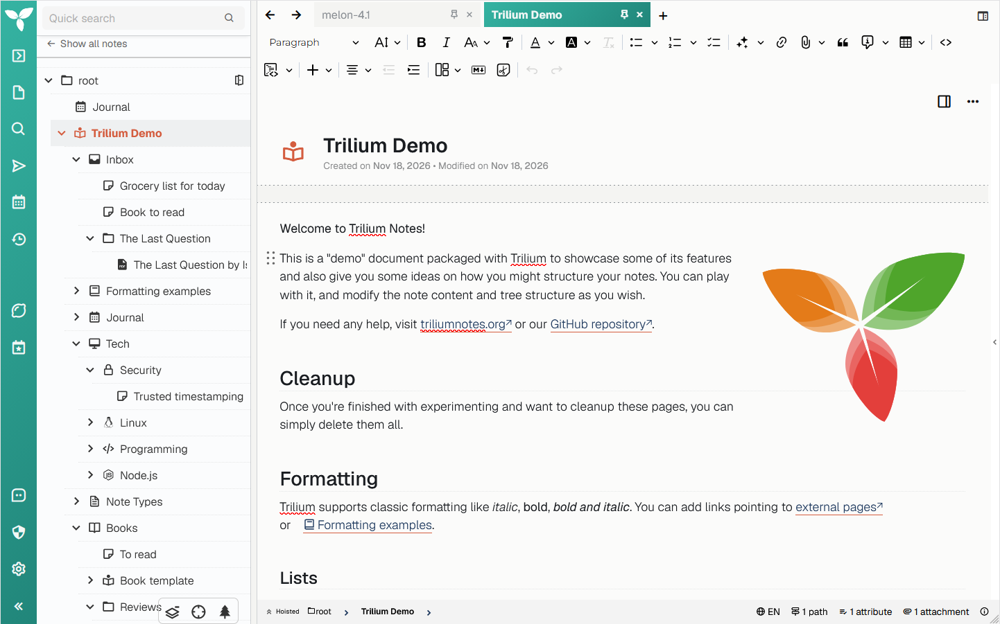

# 🍋 melon-4
A theme for [Trilium](https://github.com/TriliumNext/Trilium),  "_a hierarchical note taking application with focus on building large personal knowledge bases_". 

## Screenshots

## Theme Installation
Please follow the official instructions [here](https://docs.triliumnotes.org/user-guide/concepts/themes).

## Fonts (Suggestion)
- Geist (Notes, UI)
- Fira Code (Code/Monospace)

You can get them from this repository (./fonts-dist) as ready-to-import .zip files

### Fonts Installation
See [the official instructions](https://docs.triliumnotes.org/user-guide/concepts/themes/fonts)